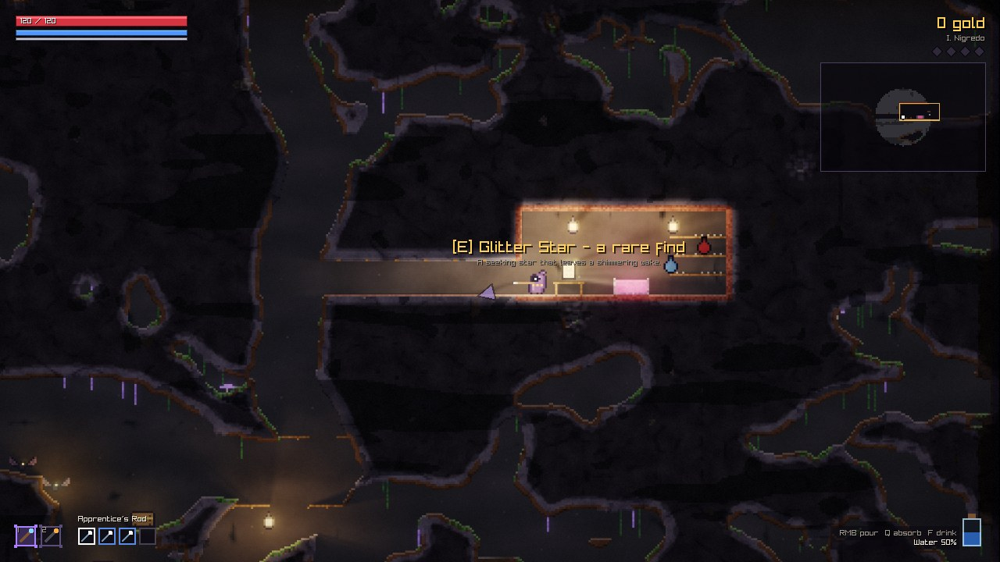
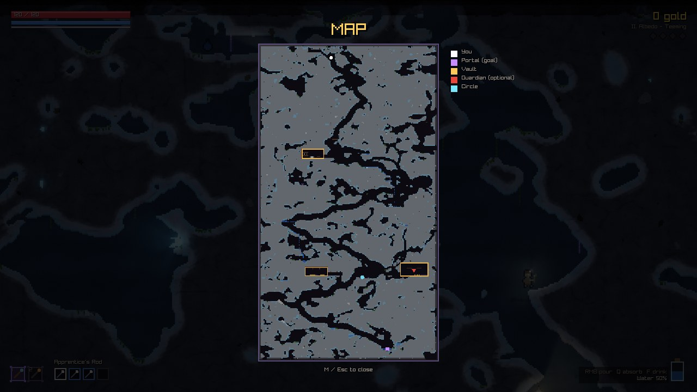
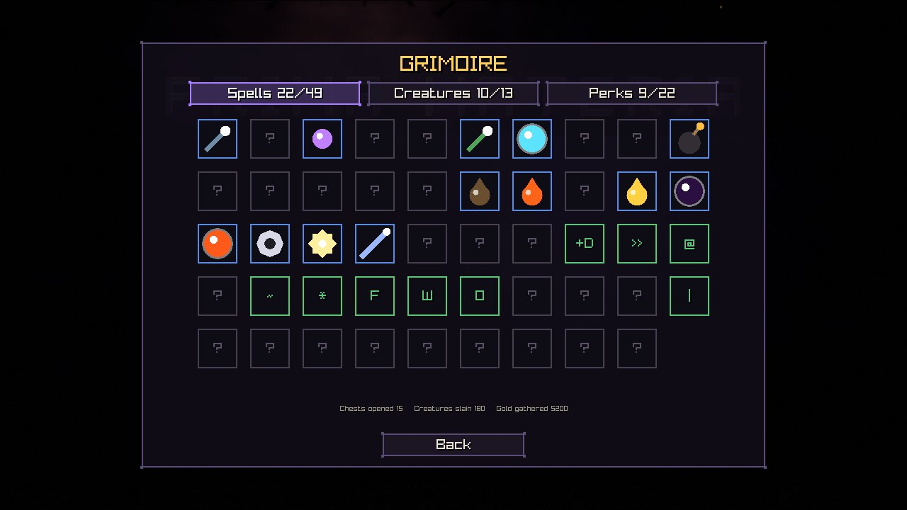
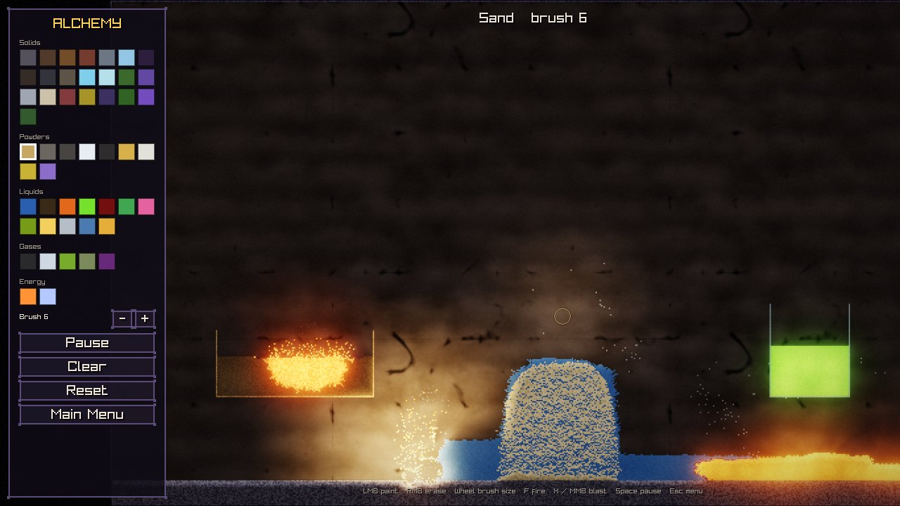
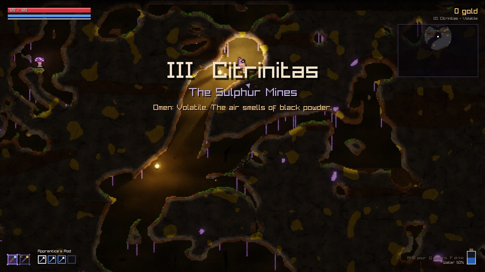
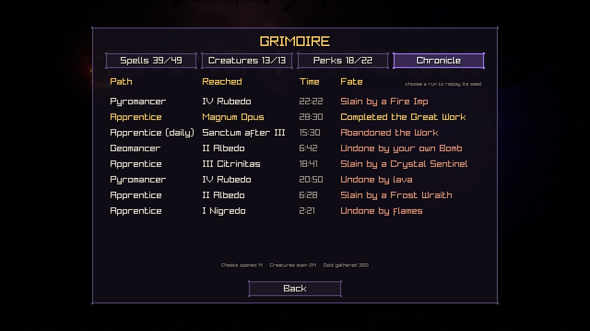
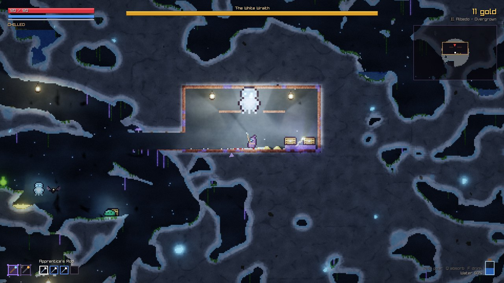
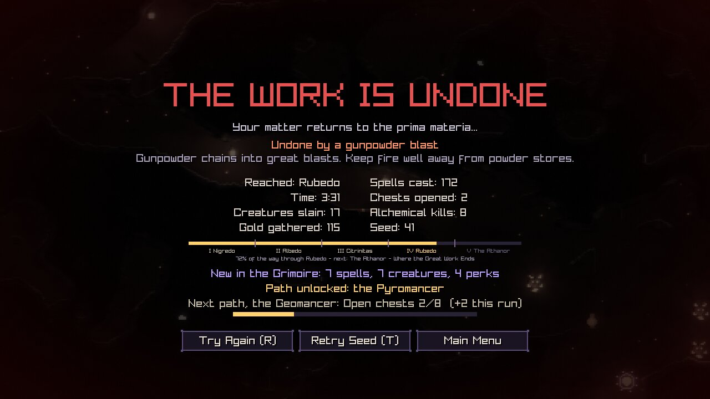
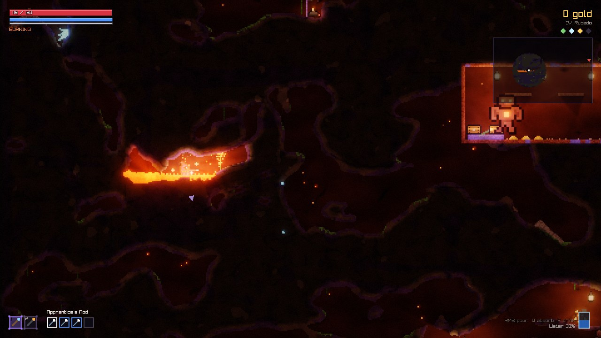
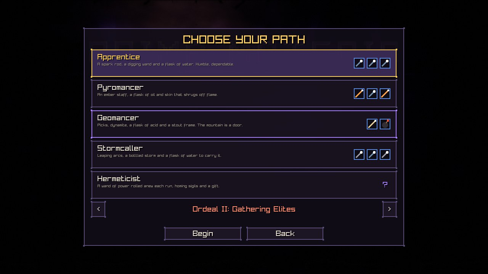

# PRIMA MATERIA

*A falling-sand alchemy roguelite.*


Every pixel of Prima Materia is simulated matter. Sand pours, water finds its level, oil
floats and burns, lava cools into obsidian when it meets water, acid eats through stone,
gunpowder chains into explosions and gold ore crumbles into collectable dust. You are an
apprentice alchemist descending through the four stages of the Great Work - *Nigredo,
Albedo, Citrinitas, Rubedo* - to face the Rebis in the Athanor, armed with wands you build
yourself from spell cards.

| | |
|---|---|
|  |  |
|  |  |
|  |  |
|  |  |
|  |  |
|  |  |
|  |  |

## Playing

**Windows 10/11 (64-bit):** download `PrimaMateria-<version>-windows-x64.zip` from the
[Releases](../../releases) page, unzip anywhere and run `PrimaMateria.exe`. No installer and
no runtime dependencies are needed. Windows SmartScreen may warn about an unsigned
executable; choose *More info -> Run anyway*.

### Controls

| Action | Keyboard & mouse | Gamepad |
|---|---|---|
| Move | `A` / `D` | Left stick |
| Jump / levitate (hold) | `W` or `Space` | A |
| Aim / cast the active wand | Mouse / left button | Right stick / RT |
| Switch wand | `1`-`4`, mouse wheel | LB / RB |
| Pour the flask / absorb matter | Right button / hold `Q` | LT / Y |
| Drink from the flask | `F` | X |
| Pick up, open, buy | `E` | B |
| Edit wands (drag & drop spells) | `Tab` | Back, then D-pad + A / Y |
| Map | `M` | D-pad down |
| Pause | `Esc` | Start |
| Fullscreen | `F11` or `Alt+Enter` | |
| Performance overlay | `F3` | |

Menus work with the mouse, the keyboard (arrows / Enter / Esc) or a gamepad (D-pad / A / B).

### How the alchemy works

- **Wands** cast their spell cards in order. *Modifiers* (Damage Plus, Homing, Fire Trail...)
  affect every projectile in the same cast, *multicasts* fire several cards at once, and
  *trigger* spells release the next card where they land. 50 spells, randomly rolled wands
  and four wand slots make every run's arsenal different. An attack spell you find drops
  straight into an empty slot of the wand in hand; the rest wait in the satchel, and the
  wand editor (`Tab`) walks you through your first drag.
- **The flask** absorbs any liquid or powder (`Q`) and pours it back out (right mouse): carry
  water to douse fires, acid to dissolve walls, oil to set traps. Drinking has effects too:
  Vitae heals, quicksilver lends haste and ichor lends your spells fury.
- **The matter lens:** rest the cursor on a substance or creature to learn what it is and
  what it does.
- **Lanterns** light the route - and can be shot down onto the creatures below, shattering
  into burning oil.
- **Elites** glow with an affix: *Burning* ones trail fire, *Swift* ones strike fast and
  *Gilded* ones bleed gold.
- **Mimics:** not every chest along the route is a chest. A mimic looks and glows exactly
  like one, but now and then it breathes; test a doubtful chest with a spell from afar.
- **The mountain stirs:** a few times a stage the ceiling caves in, a wall breaches and
  floods the passage (with lava, deep down), marsh gas seeps from a crack, a swarm comes
  out of the dark or a seam of gold gives way overhead - each announced and telegraphed a
  moment before it lands.
- **Omens** twist some stages: a *Flooded* cavern, an *Overgrown* one, a *Volatile* mine
  stocked with black powder, *Gilded* walls or a *Teeming* stage full of creatures and loot.
- **Vaults** hide off the main route: an alchemist's laboratory with a brimming cauldron, a
  powder magazine waiting for a spark, a flooded crypt, a guarded treasury and a healing
  spring.
- **Guardians:** each of the first four stages hides a lair, marked on the map, where a giant
  keeps a hoard - the Black Toad, the White Wraith, the Mine King and the Red Colossus. The
  fight is optional; win it and the guardian's essence becomes a perk and circles you. Gather
  all four essences in one run (the sockets under the stage name) and completing the Work
  earns the *Quintessence* ending.
- **Sanctums** between stages fully heal you and offer a shop and a choice of perks
  (22 perks, from *Salamander Skin* to a homunculus companion).
- **Save & Quit** from the pause menu (or just close the window) and *Continue the Work*
  from the title screen later: a run resumes at the start of the stage you were on.
- **Runs** are seeded. The *Daily Rite* gives everyone the same seed and kit for the day, and
  three difficulties tune the challenge. The death screen shows how close the next path is
  to unlocking and any personal bests, and *Retry Seed* walks the same stages again.
- **Paths:** milestones unlock four more starting loadouts - the *Pyromancer*, *Geomancer*,
  *Stormcaller* and *Hermeticist* - each with its own wands, flask and gifts.
- **Ordeals:** completing the Great Work opens the first of eight stacking ordeals, chosen
  under the paths - *Hardened Foes*, *Gathering Elites*, *Lean Sanctums*, *Dear Wares*,
  *Cruel Blows*, *Restless Mountain*, *Frail Flesh* and *Wrathful Keepers*. Each keeps the
  rules of those beneath it; complete the Work under the highest one open to unlock the next.
- **The Grimoire** records every spell discovered, creature slain and perk taken across all
  of your runs, the 25 *feats* you have earned (from *First Blood* to *Archmage*, each
  announced the moment it is won), and its chronicle remembers how your last ten runs
  ended; choose one to replay its seed.
- The **Alchemy Sandbox** on the title screen lets you paint every material freely.

## Building from source

Requirements: CMake 3.21+, a C++20 compiler (MSVC 2022+, GCC 11+ or Clang 14+) and Git.
raylib 5.5 is fetched automatically.

```sh
cmake -S . -B build -DCMAKE_BUILD_TYPE=Release
cmake --build build --config Release --parallel
ctest --test-dir build -C Release        # unit tests
```

On Linux install the X11/OpenGL/ALSA development packages first (see
`.github/workflows/build.yml`). A MinGW toolchain file for cross-compiling Windows builds
lives in `cmake/toolchains/`.

## Technical overview

Everything - art, sound and music - is generated procedurally at startup; the release is a
single self-contained executable.

**Simulation (`src/sim`).** The world is a dense grid of 6-byte cells split into 64x64
chunks with dirty rectangles, so only regions where something can change are simulated.
Each tick updates all dirty chunks in four checkerboard phases on a thread pool; a cell
never moves more than a few pixels per tick, so chunks updated in the same phase can never
touch the same memory. Rules cover powders, liquids (density layering, viscosity), gases,
fire and burning, corrosion, transmutation, melting and a pairwise reaction table. Free
particles carry matter through the air (explosion debris, sprays) and settle back into the
grid. A typical tick costs well under a millisecond.

**Rendering (`src/render`, `shaders/`).** The world is drawn at "cell resolution" into
albedo and emission layers. A light pass ray-marches up to 64 point lights per pixel
through the occlusion field for soft shadows - lava pools, fires and glowing fungus
automatically become shadow-casting lights - and a dual-Kawase pyramid provides glow and
bloom. The final composite runs at screen resolution with sub-pixel camera scrolling,
sharp-bilinear scaling, solid-depth shading, ACES tonemapping and screen effects.

**Game (`src/game`).** Data-driven spells, wands and creatures; 17 monster types with 11
behaviours (including a worm that tunnels through rock, four lair guardians and a
multi-phase boss); a fixed
60 Hz simulation with interpolated rendering for smooth high-refresh-rate play.

**Generation (`src/gen`).** Levels combine domain-warped noise caves with a guaranteed
winding route, chambers, branches, biome materials, vegetation, structures and pools, then
pre-simulate so liquids and sand settle before you arrive; omens reweight those passes to
flood, overgrow or gild a stage. A flow-field navigation grid verifies every level is
traversable (and drives the test bot).

**Audio (`src/audio`).** An sfxr-style synthesizer renders all sound effects; music is
generative - pads, bass, Karplus-Strong plucks and drums improvise in each biome's mode,
reacting to combat intensity, with fire/water/lava ambience mixed in.

### Testing tools

- `pm_tests` - unit tests for simulation invariants (conservation, reactions, blasts,
  hanging vines), generation (route and vault reachability, determinism, omens, trees), the
  spell table, deck casting, auto-slotting found spells, starting loadouts, run saves, the
  chronicle, end-screen records, death advice, lanterns, elite affixes and the matter lens.
- `PrimaMateria --play --autoplay --turbo [--god] [--seed N] [--level N]` - an autopilot
  plays through runs headlessly as an end-to-end smoke test.
- `pm_genpreview <dir>` renders full level maps; `pm_audiopreview <dir>` renders every sound
  and the music to WAV with level statistics.

### Releasing

Pushing a `v*` tag (or running the *Release* workflow by hand with a tag name) builds the
game with MSVC, runs the tests and publishes `PrimaMateria-<tag>-windows-x64.zip` as a
GitHub release with `docs/RELEASE_NOTES.md` as its text. A manual run with *dry_run*
checked does everything except publish, leaving the zip as a workflow artifact.

### Repository layout

```
src/app      application shell, input latch, settings, profile and run saves
src/core     math, RNG, noise, thread pool, profiler
src/sim      materials, cells, world/chunk scheduler, particles
src/gen      biomes, level generator, vaults, navigation grid
src/game     player, enemies, spells, wands, loadouts, projectiles, level logic, rendering glue
src/render   lighting pipeline, sprites, sky, backgrounds
src/audio    sound synthesis and generative music
src/ui       immediate-mode UI widgets, Grimoire and map panels
src/scenes   menu, game (HUD, hints) and sandbox screens
shaders/     GLSL sources embedded into the executable at build time
tests/       unit tests        tools/  developer tools        docs/  design notes
```

## Credits

Designed and programmed by Claude (Anthropic). Built with [raylib](https://www.raylib.com/)
(zlib license). All art, sound and music are procedurally generated by the game's own code.
