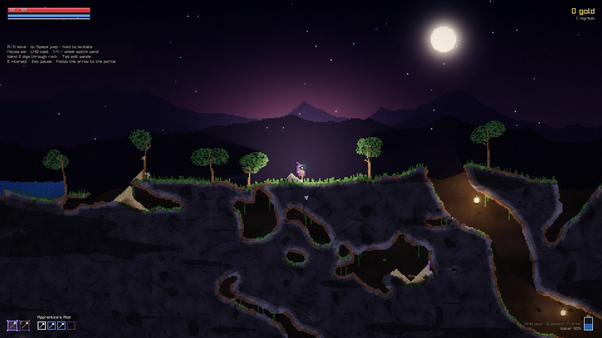
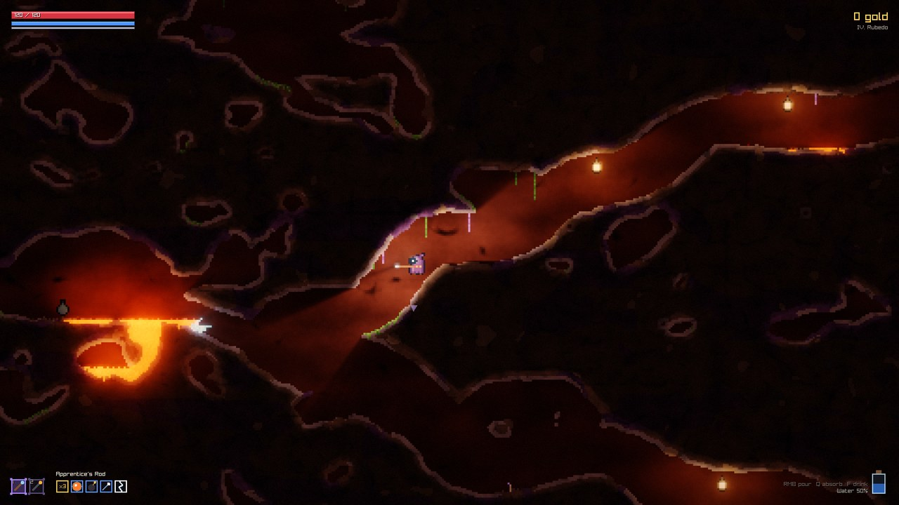
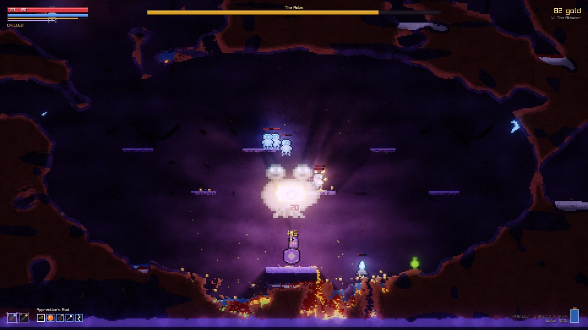
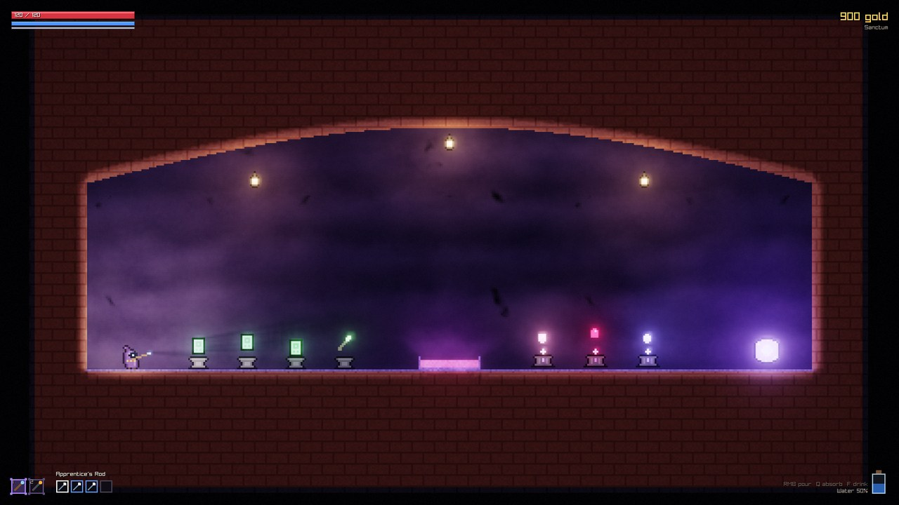
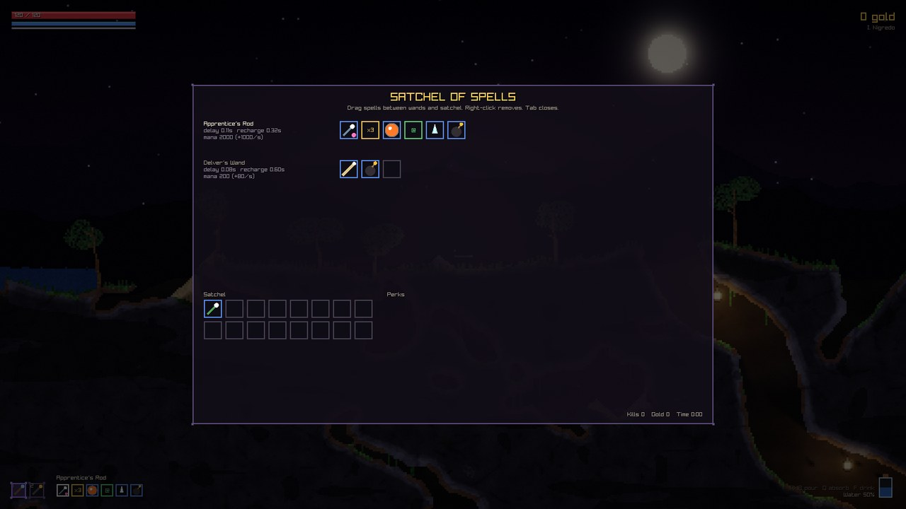

# PRIMA MATERIA

*A falling-sand alchemy roguelite.*



Every pixel of Prima Materia is simulated matter. Sand pours, water finds its level, oil
floats and burns, lava cools into obsidian when it meets water, acid eats through stone,
gunpowder chains into explosions and gold ore crumbles into collectable dust. You are an
apprentice alchemist descending through the four stages of the Great Work - *Nigredo,
Albedo, Citrinitas, Rubedo* - to face the Rebis in the Athanor, armed with wands you build
yourself from spell cards.

| | |
|---|---|
|  |  |
|  |  |

## Playing

**Windows 10/11 (64-bit):** download `PrimaMateria-<version>-windows-x64.zip` from the
[Releases](../../releases) page, unzip anywhere and run `PrimaMateria.exe`. No installer and
no runtime dependencies are needed. Windows SmartScreen may warn about an unsigned
executable; choose *More info -> Run anyway*.

### Controls

| Action | Keyboard & mouse | Gamepad |
|---|---|---|
| Move | `A` / `D` | Left stick |
| Jump / levitate (hold) | `W` or `Space` | A |
| Aim / cast the active wand | Mouse / left button | Right stick / RT |
| Switch wand | `1`-`4`, mouse wheel | LB / RB |
| Pour the flask / absorb matter | Right button / hold `Q` | LT / Y |
| Drink from the flask | `F` | X |
| Pick up, open, buy | `E` | B |
| Edit wands (drag & drop spells) | `Tab` | Back |
| Pause | `Esc` | Start |
| Fullscreen | `F11` or `Alt+Enter` | |
| Performance overlay | `F3` | |

### How the alchemy works

- **Wands** cast their spell cards in order. *Modifiers* (Damage Plus, Homing, Fire Trail...)
  affect every projectile in the same cast, *multicasts* fire several cards at once, and
  *trigger* spells release the next card where they land. 49 spells, randomly rolled wands
  and four wand slots make every run's arsenal different.
- **The flask** absorbs any liquid or powder (`Q`) and pours it back out (right mouse): carry
  water to douse fires, acid to dissolve walls, oil to set traps. Drinking has effects too -
  Vitae heals.
- **Sanctums** between stages fully heal you and offer a shop and a choice of perks
  (22 perks, from *Salamander Skin* to a homunculus companion).
- **Runs** are seeded. The *Daily Rite* gives everyone the same seed for the day, and three
  difficulties tune the challenge. Statistics persist between runs.
- The **Alchemy Sandbox** on the title screen lets you paint every material freely.

## Building from source

Requirements: CMake 3.21+, a C++20 compiler (MSVC 2022+, GCC 11+ or Clang 14+) and Git.
raylib 5.5 is fetched automatically.

```sh
cmake -S . -B build -DCMAKE_BUILD_TYPE=Release
cmake --build build --config Release --parallel
ctest --test-dir build -C Release        # unit tests
```

On Linux install the X11/OpenGL/ALSA development packages first (see
`.github/workflows/build.yml`). A MinGW toolchain file for cross-compiling Windows builds
lives in `cmake/toolchains/`.

## Technical overview

Everything - art, sound and music - is generated procedurally at startup; the release is a
single self-contained executable.

**Simulation (`src/sim`).** The world is a dense grid of 6-byte cells split into 64x64
chunks with dirty rectangles, so only regions where something can change are simulated.
Each tick updates all dirty chunks in four checkerboard phases on a thread pool; a cell
never moves more than a few pixels per tick, so chunks updated in the same phase can never
touch the same memory. Rules cover powders, liquids (density layering, viscosity), gases,
fire and burning, corrosion, transmutation, melting and a pairwise reaction table. Free
particles carry matter through the air (explosion debris, sprays) and settle back into the
grid. A typical tick costs well under a millisecond.

**Rendering (`src/render`, `shaders/`).** The world is drawn at "cell resolution" into
albedo and emission layers. A light pass ray-marches up to 64 point lights per pixel
through the occlusion field for soft shadows - lava pools, fires and glowing fungus
automatically become shadow-casting lights - and a dual-Kawase pyramid provides glow and
bloom. The final composite runs at screen resolution with sub-pixel camera scrolling,
sharp-bilinear scaling, solid-depth shading, ACES tonemapping and screen effects.

**Game (`src/game`).** Data-driven spells, wands and creatures; 14 monster types with 11
behaviours (including a worm that tunnels through rock and a multi-phase boss); a fixed
60 Hz simulation with interpolated rendering for smooth high-refresh-rate play.

**Generation (`src/gen`).** Levels combine domain-warped noise caves with a guaranteed
winding route, chambers, branches, biome materials, vegetation, structures and pools, then
pre-simulate so liquids and sand settle before you arrive. A flow-field navigation grid
verifies every level is traversable (and drives the test bot).

**Audio (`src/audio`).** An sfxr-style synthesizer renders all sound effects; music is
generative - pads, bass, Karplus-Strong plucks and drums improvise in each biome's mode,
reacting to combat intensity, with fire/water/lava ambience mixed in.

### Testing tools

- `pm_tests` - unit tests for simulation invariants, generation connectivity and determinism.
- `PrimaMateria --play --autoplay --turbo [--god] [--seed N] [--level N]` - an autopilot
  plays through runs headlessly as an end-to-end smoke test.
- `pm_genpreview <dir>` renders full level maps; `pm_audiopreview <dir>` renders every sound
  and the music to WAV with level statistics.

### Repository layout

```
src/app      application shell, settings and profile persistence
src/core     math, RNG, noise, thread pool, profiler
src/sim      materials, cells, world/chunk scheduler, particles
src/gen      biomes, level generator, navigation grid
src/game     player, enemies, spells, wands, projectiles, level logic, rendering glue
src/render   lighting pipeline, sprites, sky, backgrounds
src/audio    sound synthesis and generative music
src/ui       immediate-mode UI widgets
src/scenes   menu, game and sandbox screens
shaders/     GLSL sources embedded into the executable at build time
tests/       unit tests        tools/  developer tools        docs/  design notes
```

## Credits

Designed and programmed by Claude (Anthropic). Built with [raylib](https://www.raylib.com/)
(zlib license). All art, sound and music are procedurally generated by the game's own code.
